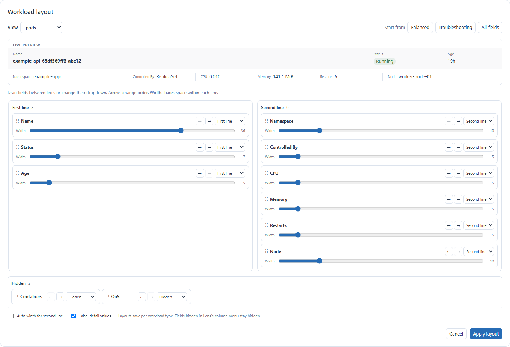

# Rowcraft for Lens

Customize Lens workload tables with two-line rows and a visual layout editor.

## Install from Marketplace (WIP)

## Compatibility

Prototype targets **Lens 2026.11.91422-latest**. Lens has no public row-height or row-layout extension API. This extension therefore uses an experimental adapter to locate the workload table's React-owned virtualizer, double its row measurements and apply a two-line CSS grid. It does not modify Lens application files or Kubernetes resources, and makes no network requests.

Unknown table structures are left unchanged. A future Lens update may require an adapter update. If the layout misbehaves, turn it off using the status-bar button or disable the extension in Lens. Automated checks cover the layout editor, configuration validation, field placement, row measurement, scrolling, React updates and restoration. The visual editor and Lens persistence integration still need live Lens verification.

## License

Copyright 2026 Pavel Manakov. Licensed under [Apache License 2.0](LICENSE). See [NOTICE](NOTICE) for attribution.
